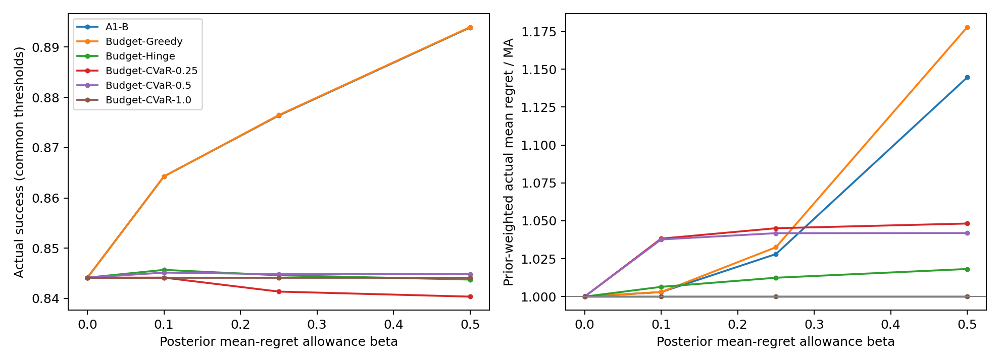
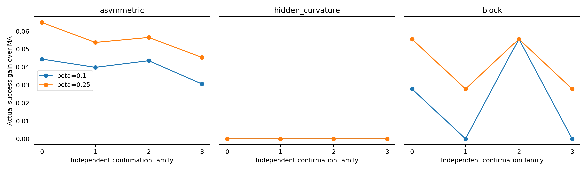
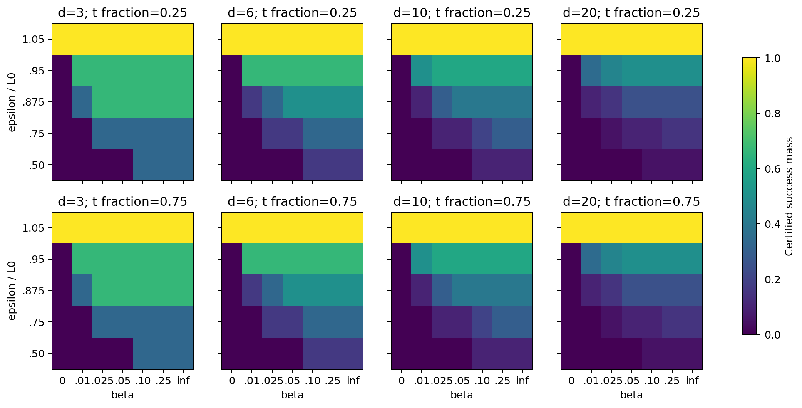
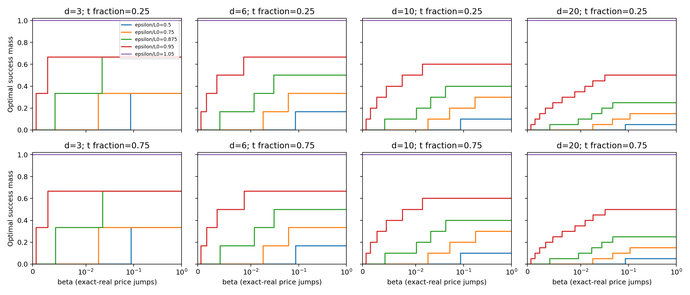
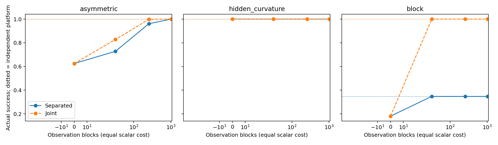
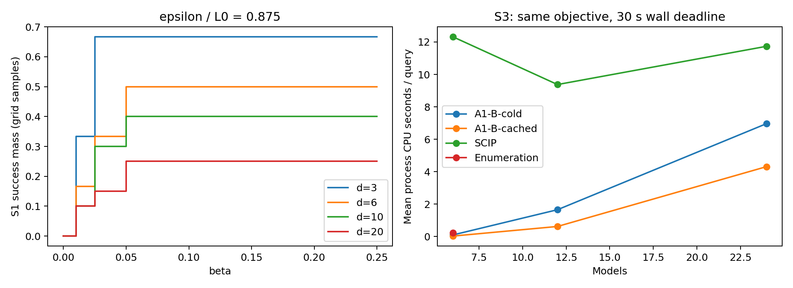

> **部分验收：最终审计未通过；CPU 超限 6.70 秒；完整归档未完成。请同时阅读文末最终状态。**

# research_v4a：平均代价受控的决策兼容性实验报告

本轮仅研究 A1-B。原始 v3 结果不参与本轮显著性检验；以下数字来自新种子的确认族。

主实证口径：12 个独立确认风险族，三个冻结公共阈值，两个 mask 和正样本量等权。MA 达标率 84.41%；A1-B 在 10% / 25% 后验平均 regret 预算下为 86.43% / 87.64%。区间未决事件按下界计，完整上下界保存在汇总文件。

新版无预算 A1-B 达标率 90.58%，旧 A1 为 90.56%；实际均值 regret 相对 MA 分别为 1.3102 / 1.8562。旧算法破同分与全局二级优化分列，不能把二者差异全部归因于平均预算。

## 固定设计与完成情况

- 起点：`edac208d27e8751faab5a2ca94a1cd267cd4439b`；独立分支 `research/decision-compatible-v4a`，只作本地提交。
- 附件原文及 SHA256、冻结配置、全部族矩阵、随机种子和版本均已保存。开发族与确认族独立，不按胜负改族。
- 开发 affinity 界触发统一 n=1024；n=[0, 32, 256, 1024]。公共 ε/u=[0.0016512875809021929, 0.011863236445932387, 0.13477080327614221]；几何诊断网格单列，不混入主要检验。
- 确认已完成 4344/4344 个决策数据集（预期 4320 个非零 + 24 个零样本设计）；零样本组合评价全部真模型。重复阈值、方法和预算不是独立数据集。
- 本报告生成前台账累计实验 CPU 5.973 小时；最终准确总量见 execution_summary.json 和 runtime_ledger.jsonl。墙钟与累计 CPU 分列，安装和 Git 操作不计实验 CPU。
- 预确认修订了 surrogate 可行修正后的目标上界记录。随后审计发现 MILP 对小概率系数的数值尺度问题：用固定 1e6 尺度重算 A1-B 和旧 A1 的全部数据，并重跑完整 S3，所有初始记录均保留；设计、种子、观测、阈值、预算和重复数不变。正式结果仅使用 validated 记录。

## 主性能与平均代价

| 方法 | β | 实际达标率区间 | 后验成功质量 | 实际均值 / MA | p95 regret | 确定失败条件 regret | 最坏模型达标率（族均值） | 预算认证率 |
| --- | ---: | ---: | ---: | ---: | ---: | ---: | ---: | ---: |
| A1-B | 0.0 | [0.8441, 0.8441] | 0.8452 | 1.0000 | 0.005587 | 0.003615 | 0.8074 | 0.00% |
| A1-B | 0.1 | [0.8643, 0.8643] | 0.8649 | 1.0030 | 0.005631 | 0.003867 | 0.8514 | 60.76% |
| A1-B | 0.25 | [0.8764, 0.8764] | 0.8772 | 1.0281 | 0.005631 | 0.00435 | 0.8569 | 61.48% |
| A1-B | 0.5 | [0.8939, 0.8939] | 0.8947 | 1.1446 | 0.00651 | 0.005878 | 0.8602 | 61.85% |
| A1-B | inf | [0.9058, 0.9058] | 0.9068 | 1.3102 | 0.008009 | 0.007834 | 0.8611 | 100.00% |
| A1-v3 | inf | [0.9056, 0.9056] | 0.9068 | 1.8562 | 0.009227 | 0.009888 | 0.8611 | 100.00% |
| Budget-CVaR-0.25 | 0.0 | [0.8441, 0.8441] | 0.8452 | 1.0000 | 0.005587 | 0.003615 | 0.8074 | 0.00% |
| Budget-CVaR-0.25 | 0.1 | [0.8441, 0.8441] | 0.8446 | 1.0383 | 0.005201 | 0.003504 | 0.8329 | 60.07% |
| Budget-CVaR-0.25 | 0.25 | [0.8414, 0.8414] | 0.8413 | 1.0451 | 0.005201 | 0.003461 | 0.8301 | 61.50% |
| Budget-CVaR-0.25 | 0.5 | [0.8404, 0.8404] | 0.8398 | 1.0482 | 0.005201 | 0.003443 | 0.8310 | 61.85% |
| Budget-CVaR-0.25 | inf | [0.8400, 0.8400] | 0.8394 | 1.0502 | 0.005201 | 0.00344 | 0.8310 | 100.00% |
| Budget-CVaR-0.5 | 0.0 | [0.8441, 0.8441] | 0.8452 | 1.0000 | 0.005587 | 0.003615 | 0.8074 | 0.00% |
| Budget-CVaR-0.5 | 0.1 | [0.8451, 0.8451] | 0.8459 | 1.0377 | 0.005201 | 0.003523 | 0.8347 | 60.76% |
| Budget-CVaR-0.5 | 0.25 | [0.8448, 0.8448] | 0.8456 | 1.0418 | 0.005201 | 0.003526 | 0.8343 | 61.48% |
| Budget-CVaR-0.5 | 0.5 | [0.8448, 0.8448] | 0.8456 | 1.0419 | 0.005201 | 0.003526 | 0.8343 | 61.85% |
| Budget-CVaR-0.5 | inf | [0.8448, 0.8448] | 0.8456 | 1.0419 | 0.005201 | 0.003526 | 0.8343 | 100.00% |
| Budget-CVaR-1.0 | 0.0 | [0.8441, 0.8441] | 0.8452 | 1.0000 | 0.005587 | 0.003615 | 0.8074 | 0.00% |
| Budget-CVaR-1.0 | 0.1 | [0.8441, 0.8441] | 0.8452 | 1.0000 | 0.005587 | 0.003615 | 0.8074 | 60.76% |
| Budget-CVaR-1.0 | 0.25 | [0.8441, 0.8441] | 0.8452 | 1.0000 | 0.005587 | 0.003615 | 0.8074 | 61.48% |
| Budget-CVaR-1.0 | 0.5 | [0.8441, 0.8441] | 0.8452 | 1.0000 | 0.005587 | 0.003615 | 0.8074 | 61.85% |
| Budget-CVaR-1.0 | inf | [0.8441, 0.8441] | 0.8452 | 1.0000 | 0.005587 | 0.003615 | 0.8074 | 100.00% |
| Budget-Greedy | 0.0 | [0.8441, 0.8441] | 0.8452 | 1.0000 | 0.005587 | 0.003615 | 0.8074 | 0.00% |
| Budget-Greedy | 0.1 | [0.8643, 0.8643] | 0.8649 | 1.0030 | 0.005631 | 0.003867 | 0.8514 | 60.77% |
| Budget-Greedy | 0.25 | [0.8765, 0.8765] | 0.8772 | 1.0326 | 0.005631 | 0.004352 | 0.8569 | 61.50% |
| Budget-Greedy | 0.5 | [0.8940, 0.8940] | 0.8947 | 1.1778 | 0.006929 | 0.006099 | 0.8602 | 61.85% |
| Budget-Greedy | inf | [0.9059, 0.9059] | 0.9068 | 1.8012 | 0.009227 | 0.009904 | 0.8611 | 100.00% |
| Budget-Hinge | 0.0 | [0.8441, 0.8441] | 0.8452 | 1.0000 | 0.005587 | 0.003615 | 0.8074 | 0.00% |
| Budget-Hinge | 0.1 | [0.8457, 0.8515] | 0.8462 | 1.0064 | 0.005587 | 0.003533 | 0.8338 | 60.76% |
| Budget-Hinge | 0.25 | [0.8446, 0.8523] | 0.8449 | 1.0125 | 0.005587 | 0.003547 | 0.8310 | 61.49% |
| Budget-Hinge | 0.5 | [0.8438, 0.8532] | 0.8438 | 1.0182 | 0.005587 | 0.003566 | 0.8324 | 61.85% |
| Budget-Hinge | inf | [0.8387, 0.8527] | 0.8377 | 1.2274 | 0.005631 | 0.003551 | 0.8259 | 100.00% |
| MA | 0.0 | [0.8441, 0.8441] | 0.8452 | 1.0000 | 0.005587 | 0.003615 | 0.8074 | 0.00% |

相对 新版 β=∞ 的超过 MA 部分，10% / 25% 预算保留 32.7% / 52.3%。这是描述性比值，分母接近零时不稳定，不能替代预设配对检验。

相对 旧 A1（同一批新数据） 的超过 MA 部分，10% / 25% 预算保留 32.7% / 52.4%。这是描述性比值，分母接近零时不稳定，不能替代预设配对检验。

后验预算约束是逐数据集的条件平均约束，并不保证每个真模型的样本外平均代价比例。实际均值以先验均匀、模型/观测/阈值等权汇总；p95 是该平衡设计中的经验统计。失败条件均值仅针对已确定失败的事件，不把边界未决事件当作确定失败，也不对缺失持仓插补有限 regret。成功比较始终保留未决及缺失事件的上下界；失效与未完成数另见审计。

## 预设四项检验

固定种子的 10,000 次分层族级 bootstrap；每类只重采样其 4 个独立确认族。双侧族级符号随机化以效应对称为检验假设；对 4 项总体检验 Holm 校正。成功边界不确定性向效应两端传播。

| β | 对照 | 配对达标率差区间 | Bootstrap 95% 区间 | Holm p（保守上界） |
| ---: | --- | ---: | ---: | ---: |
| 0.1 | Budget-Greedy | [0.00000, 0.00000] | [-0.00023, 0.00023] | 1.00000 |
| 0.1 | Budget-Hinge | [0.01281, 0.01860] | [0.00965, 0.02346] | 0.56250 |
| 0.25 | Budget-Greedy | [-0.00008, -0.00008] | [-0.00023, 0.00000] | 1.00000 |
| 0.25 | Budget-Hinge | [0.02407, 0.03179] | [0.02315, 0.03349] | 0.15625 |

每类 n=4，逐族效应及区间比单独的类内显著性更有解释力；不能把 4320 个观测数据集称为 4320 个独立风险族。所有 CVaR ρ 均列出，没有事后选择最优 ρ。

## 兼容价格、平台与计算

S1 的 280 个预算查询通过解析质量核验；独立 CVXPY 价格核验与通用求解分列。置换对称约简只适用于该解析族。S1 确定性选择的最坏模型成功率与均匀随机兼容组的覆盖率不同，详见 S1 附加检查。

全部可达基数的 Γ_m、β_m、代价和解析见证另存 S1_analytic_prices.json；下图画出完整解析台阶，独立数值边界证书见 S1_boundaries.json。解析曲线本身不作为算法性能成绩。

平台通过枚举六模型集合计算，并对可行集合用独立 CVXPY 复核价格。Joint 和 Separated 每块同为 d 个标量、来自两个独立时点；空时点不提供信息。预算间隔为零时保留左右界，不宣称集合最终稳定。

S3 的冷启动、同后验缓存、枚举及独立安装 SCIP 使用同一主成功目标和全局二级代价。公共预计算与缓存构建必须计入完整成本；图中逐查询 CPU 不包括已另存的公共族生成成本。超时的 incumbent 和开放 gap 都保留，不能将其与已证最优的速度直接排名。

## 数值与理论边界

QP/QCQP 原始对偶值、可行残差和近零 L* 状态逐实例保存。成功区间与主最优区间分开；主目标闭合而二级仍开放时保留 success_optimal_secondary_open。浮点舍入余量不是严格有向区间证明；高精度 KKT 检查是数值审计，不是新统计方法。

主实证 A1-B 的逐实例预算认证率为 60.76% / 61.48%。返回持仓的实际成功表现与预算认证是两个字段；未认证实例仍保留在比较中，不能因此宣称每个实例都满足严格相对限额。高度集中的后验会使 L* 小于浮点 oracle 误差，尤其应检查 budget_certified，而不是只读主优化 status。β=0 仍按协议返回 MA，但正的浮点 QP 误差界不能认证字面上的零增量；其实际持仓成功率照常报告，严格预算与主/二级证书保留开放。所有未经预算认证的数值 incumbent 都经过 certificate_qualification.py 收紧资格，原始名义字段与持仓保留。

有限高斯似然和均匀先验下出现浮点零后验时，统一按保存的 log density 作 80 位精度误差核查，并用保守误差界扩大数值区间；未证明预算间隔的主目标和全局二级目标保留开放。汇总应用这些资格修订，但原始名义证书不覆盖，持仓与实际成功标签不变。主质量 ≤1e-8 的容差也不等于每个极小后验权重在严格二级排序中都可以忽略；新版无预算与旧 A1 的平均代价差不能全解读为精确同主目标的破同分收益。

理论状态表见 THEORY.md。兼容集合、Helly、最大可行子系统、似然 affinity 与 MA 的 Bayes 均值最优性均基于经典工具。[Park–Lee](https://arxiv.org/html/2606.08895v1) 已直接研究不相容集合与错误指数，本轮不以此为原创。连续持仓的价格公式和有预算的部分识别结论是候选增量，优先性尚不能由本轮实验确认。正确后验下的优化优势不能直接称为泛化优势；新风险族确认用于测量前沿大小和相对强基线差距，不提供模型失配或真实回测的证据。

## 最终判断

平均代价约束下相对 MA 的总体达标率变化为 2.01 / 3.23 个百分点。是否保留跨族收益，应结合逐族结果及预设强基线比较判断，不能只看优化目标的后验提升。
四项预设比较中，0 项取得正效应且保守 Holm p<0.05。精确前沿机制已获数值支持；统计增量与同目标求解增量分别解释。失败、开放证书和未完成单元都保留，不能据赢家补跑。

## 同目标求解附表

| M | 方法 | 查询数 | 主 gap≤1e-8 | 全局二级闭合 | 平均 CPU 秒 | 中位经过秒 |
| ---: | --- | ---: | ---: | ---: | ---: | ---: |
| 6 | A1-B-cold | 60 | 80.0% | 53.3% | 0.1023 | 0.0525 |
| 6 | A1-B-cached | 60 | 80.0% | 53.3% | 0.0312 | 0.0021 |
| 6 | SCIP | 60 | 51.7% | 21.7% | 12.3161 | 1.4498 |
| 6 | Enumeration | 60 | 80.0% | 53.3% | 0.2315 | 0.2143 |
| 12 | A1-B-cold | 60 | 70.0% | 53.3% | 1.6570 | 0.1369 |
| 12 | A1-B-cached | 60 | 70.0% | 53.3% | 0.6245 | 0.0087 |
| 12 | SCIP | 60 | 45.0% | 26.7% | 9.3745 | 1.2184 |
| 24 | A1-B-cold | 60 | 73.3% | 40.0% | 6.9638 | 1.3388 |
| 24 | A1-B-cached | 60 | 73.3% | 40.0% | 4.3125 | 0.0154 |
| 24 | SCIP | 60 | 48.3% | 26.7% | 11.7328 | 2.9954 |

## 后验扰动与跳点资格

| δ | 检查数 | 收紧预算非负 | 成功下界为正 | 预算上界认证 | 成功下界认证 |
| ---: | ---: | ---: | ---: | ---: | ---: |
| 0 | 0 | 0 | 0 | 0 | 0 |
| 0.0001 | 0 | 0 | 0 | 0 | 0 |
| 0.001 | 0 | 0 | 0 | 0 | 0 |
| 0.01 | 0 | 0 | 0 | 0 | 0 |

预定 20 个实例，已记录 0 个实例；是否每个位置都完成，以 missing_cells.json 为准。其中 0/0 个名义价格位置的两侧成功平台能被区间严格分开；其余只称为价格上界附近的数值压力位置，不声称已定位一个真实成功台阶。收紧预算为负或成功下界非正时，式（26）对成功的保证是不可用或空泛的，不能将这类通过计为有力的稳定性证据。

S3 同目标求解已完成全部 600 个预定查询；修订后扰动压力另有 240 个未完成位置。上述均值包含超时，不能据均值单独宣称速度优势；应同时看主/二级闭合率。每一族的公共生成/likelihood/oracle 与每一 ε 的缓存初始化耗时在原始行保存；相同元数据是重复引用，汇总时只加一次。冷/缓存方法的族 oracle 预计算相同，不计作缓存独有收益。

参考证书修订：原始枚举和平台曾在 β=∞ 时因 `inf <= inf` 将几何已证不兼容的集合计入候选上界，导致保守但不必要的开放 gap；S1 的零预算全成功点也未将实际持仓质量提升为主下界。已独立复核并单列收紧证书，原始记录完整保留。该参考上界修订不改变持仓；另一次 scaled-mass-v2 修复则重算了受影响方法的全部固定数据。上述枚举主 gap 使用收紧后的证书；原生枚举计时包含全局二级定价，另存全部 63 个子集的 CVXPY 建模审计成本。独立 CVXPY 点值的 44 个精度分歧经过 80 位原始/弱对偶复核，2 个获得高精度认证，42 个近零 L* 实例仍保留价格开放状态，没有放宽 ε 或预算。

## 最终验收状态：部分完成，审计未通过

本状态优先于报告中各阶段的局部通过表述。S1 完成 280 个预算查询；S2 完成 444 个开发与 4344 个确认设计视图；S3 同目标求解完成 600 个查询。固定四项主检验和 10,000 次族级 bootstrap 已汇总。没有向 GitHub 推送。

主要证据支持“预算限制仍保留一部分达标收益”：MA 为 84.41%，A1-B 在 β=0.10/0.25 时为 86.43%/87.64%，保留新版无预算额外收益的 32.7%/52.3%。平衡设计下实际平均 regret 相对 MA 为 1.0030/1.0281。但这不是逐实例严格预算均已认证：预算认证率只有 60.76%/61.48%，近零 L* 与后验下溢实例保留开放。

相对强基线没有得到足够的算法优越性证据。A1-B 与 Budget-Greedy 的总体达标率基本相同；相对 Budget-Hinge 的方向为正，但四项保守 Holm 检验均未显著。不能据此宣称新算法跨族优于简单贪心。S3 显示缓存减少重复几何求解，并有低于 SCIP 的单查询耗时，但主/二级证书并非全部闭合，因此只能称计算效率的初步证据。公共预计算仍需纳入端到端比较。

最终 audit.json 的 passed=false：在 `S2-confirmation-asymmetric-10-6-confirmation-0-Separated-256-0-4`、几何阈值 0.75、β=∞，旧持仓与新持仓成功质量相同，而新版平均增量下界高于旧版上界约 1.08e-13，超过本例按极小 L* 归一化的容差。该例原始二级 gap=0 的声明未获验收，详见 secondary_audit_counterexample.json。未更改持仓、删除该例或将审核改为通过；在继续研究前须修复并重新核验二级证书。该例不属于预设公共阈值主检验，但限制了“已精确实现全局二级优化”的结论。

累计已登记进程 CPU 为 21606.703125 秒（6 小时 6.703125 秒），超过 21600 秒上限 6.703125 秒。原因是最终汇总读入后的汇总和绘图段没有及时检查预算；归档进程随后在入口被预算检查拒绝。所有失败阶段均保留，没有扣除失败计算。新增了汇总阶段检查点，但预算耗尽后没有再运行验证，不能声称预算控制已通过回归测试。此后仅完成文字说明、文件登记与本地 Git 提交。

未完成项：修订后 S3 后验扰动 20 个实例/240 个位置，最终 delivery_check，最终 Python provenance 重跑，以及全量无损压缩归档。原始扰动初跑完整保留为 S3_perturbation_initial.jsonl，仅作名义压力诊断；不冒充修订后跳点认证。全部大型逐实例原始日志完整留在本地 results 目录，但未收入 Git；提交中的 raw_local_inventory.json 说明路径和大小。Git 提交可阅读代码、配置、图表、汇总及关键小型原始证据，不能独立重建本轮全部原始流。

汇总代码另发现公共预计算元数据被不含该字段的枚举行覆盖为零，已修复聚合代码；预算耗尽后没有重跑。旧 computation_summary.json 的预计算、缓存初始化、端到端字段已置为 null，逐查询 CPU、墙钟和闭合率仍保留。不得用这些缺失字段声称完整成本优势。最终环境补充与源码哈希通过文件登记保存，environment.json 是较早阶段快照。

研究判断：兼容性价格与预算前沿值得作为理论机制继续整理；本轮尚不足以建立相对贪心的统计优势或完成全精度数值验收。下一步优先解决相对极小 L* 的证书与全量归档，而不是增加算法方向、真实回测或择优补跑。
