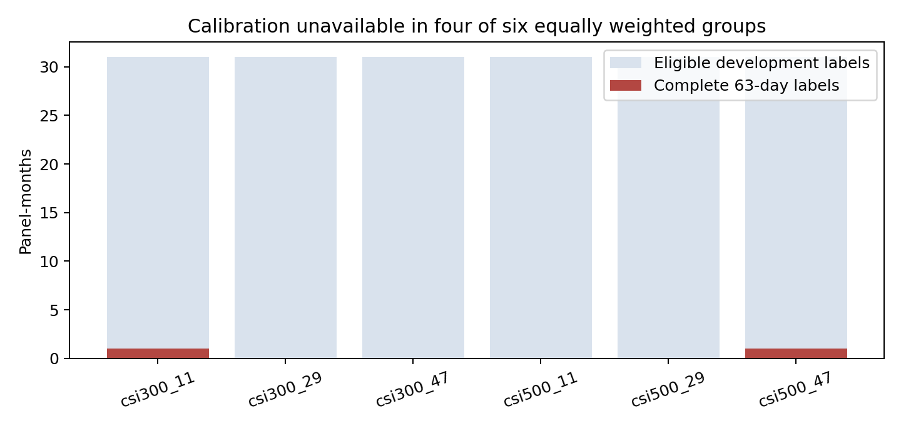
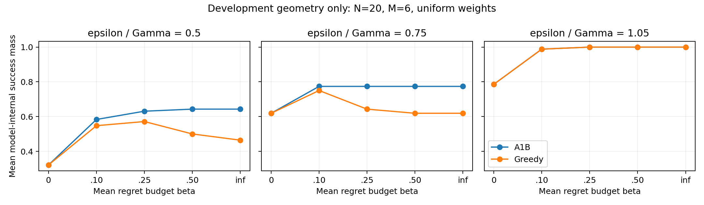

# research_v5_ashare：真实 A 股实验阶段报告

本轮状态：**开发标签校准不足，协议冻结被阻止；真实测试比较尚未开始。** 这不是“算法在 A 股失败”的结论，也不是完整 R1—R4 已完成的报告。

## 研究问题与版本

研究 A1-B 在受控平均模型 regret 下，是否能提高真实未来经验风险达标率，收益是否抵得过平均风险与交易成本，以及共同观测和规模扩展的影响。

基线提交 `f19453377892cbc7bb9aa8a79f3cfc117e74eb0b`，独立分支 `research/ashare-budgeted-dcl-v1`。协议原文见 [INPUT_PROTOCOL_ZH.md](INPUT_PROTOCOL_ZH.md)，SHA256 为 `d52af6195f590818db8d68629dabf02fe5d2306696e42b90dd789192545feb92`。本次仅本地交付，没有 GitHub 推送。v4a 冻结结果和源数据未修改。

## 1. 最关键的发现：完整未来标签不足

开发期共 216 个预定“月末×指数×面板”实例。严格按照信号后第 2 个交易日起 63 条总收益、标签终点处于开发期内进行评价：

| 状态 | 实例数 |
|---|---:|
| 完整标签 | 2 |
| 有未来收益缺失 | 184 |
| 标签跨越开发阶段终点 | 24 |
| 月末成分未核验 | 6 |
| 合计 | 216 |

在时间边界和成分已满足的 186 个实例中，只有 2/186（1.08%）能形成完整的 50 股×63 日标签。沪深300-panel11 与中证500-panel47 各有 1 个，其余四个组为 0。仅用这两条标签不能构造协议指定的六组等权校准分布。

缺失诊断发现 17,129 个原始总收益缺失单元（按面板计数，包含重复证券日期）；这些单元的历史交易状态也全部缺失。本次开发标签内由 `total_adjustment_suspect` 额外剔除的单元为 0。因此，即使忽略异常标志，完整标签数仍是 2，并非严格数值证书或异常过滤导致的结果。源清洗程序对交易日重建索引，字段字典明确说明“缺失不自动解释为停牌”。

协议第 7.3 节明确规定：“开发集不足则停止‘冻结’阶段并报告，不能借测试集补校准。”第 8.4 节同时要求不能将供应商不明缺失自动解释为停牌。因此 τ 没有数值、η 与实用 GMV 参数未进入最终冻结。没有用测试期标签、未来存活筛选、零填充或缩小持仓池补救。

这与“超过90%开发实例 A1-B/MA 相同”的退化闸门不同：**后者尚未执行，不能宣称已经触发。** 更早的标签可识别性闸门已阻止主实验。

详细聚合证据：[标签审计](output/label_data_audit.json)、[校准状态](output/tau_calibration.json)。证券日期明细只保存于私有目录 `label_missing_details.json`。

## 2. 数据覆盖及实施资格

行情 Parquet 有 13,912,860 行，缓存日历覆盖 2011-10-10—2026-09-30，3,641 个交易日、5,841 个证券代码；身份—日期重复数为 0。收益单位采用小数，普通交易日用原始收盘收益关系交叉检查。完整源文件哈希见 [数据审计](output/data_audit.json)。超大原始收益、异常标志及公司行动口径保留审计信息；这不等于每个原始异常已获金融含义认证。

成分使用 `current.json` 指向的 `daily_v1_20261012`，冻结实际文件哈希，未使用旧 `member_*_approx`。名称严格为“每日并集核验的历史查询名单”，不是完整公告时点认证的 point-in-time 数据。

2020—2025 的 6/72（8.33%）未核验月末为：2021-06-30、2021-09-30、2021-12-31、2022-12-30、2023-01-31、2023-02-28。它们保留在预定清单，触发覆盖率警报；未来执行时应共同未决、暂停调仓，而非换用有利日期。

按过去 567/63 日有效收益、20 日成交额、当日正常交易状态和稳定 SHA256 规则，已递推生成 918 个面板月清单，其中 876 个 ready。N 扩展采用共同排序前缀，保留优先级由上一期 N=50 主面板定义，公开记录此实现选择。清单只使用各日以前信息，未使用未来可交易性。

当前数据没有完整且独立核验的分红、拆并股和换股事件账册；历史手数和公告时点亦不完整。旧 `execution_dividend` 属于推断近似，未当作事实输入。已实现和手工样例验证原始股数/现金账本原语，但**没有运行真实连续净值账本，也没有获得 L1 实施认证**。

## 3. 已运行的求解与价格诊断

完成指定 20 个 N=20/M=6 开发计时实例，以及前四个追加 N=50/M=12 实例。F1 包含零均值 Gaussian EM、三历史长度和对角收缩；逐步评分的每一天仅拟合此前数据，按固定 N 归一化，权重使用 log-sum-exp、不设概率 floor。原始分数、估计状态和共享成本 ID 留在私有缓存。

为保留有用的模型几何证据，另对预定 2015/2016 季度×两指数的 16 个开发实例做 **均匀权重、几何阈值诊断**：2 个实例在 2015-12-31 因成分未核验而保留未执行；其余 14 个实例各使用 ε/Γ(all)=0.5、0.75、1.05，共 42 个几何问题。每个穷举全部 64 个子集（含空集），共 2,688 个子集；使用独立 CVXPY 建模复核价格。

**这是 R1 的几何子网格，不是已完成的正式 R1。** 统一使用 p=1/6，尚无验证选择的 η，也无三档公共 τ；不将几何阈值替代主实证阈值。下表仅为 14 个可运行开发实例的平均模型内成功质量，两个未核验实例另外保留，不能当作无缺失的市场结果：

| ε/Γ(all) | MA | A1-B β=.10 | Greedy β=.10 | A1-B β=.25 | Greedy β=.25 |
|---|---:|---:|---:|---:|---:|
| 0.5 | 0.3214 | 0.5833 | 0.5476 | 0.6310 | 0.5714 |
| 0.75 | 0.6190 | 0.7738 | 0.7500 | 0.7738 | 0.6429 |
| 1.05 | 0.7857 | 0.9881 | 0.9881 | 1.0000 | 1.0000 |

这些结果说明，在这部分真实历史估计风险库和预定几何阈值下，兼容性优化并非恒等于 MA；存在可计算的模型内成功质量改善。但本表没有未来达标率、投资收益或经济成本结论。Greedy 的固定顺序和预算改变可能导致不同组合，曲线不必随预算单调；它不是全局最优算法。

独立价格比较共有 1,749 个双方有限值，价格点与已保存价格区间的最大距离为 5.98×10⁻⁹ 个风险单位。本次使用 10⁻⁶ 风险单位作诊断报警阈值，未发现越过该阈值的矛盾；**不是重新证明 v4a 所有价格区间严格有效**。存在 Clarabel `AlmostSolved`、CVXPY 不精确状态及零预算数值开放，完整保留，不把警告当作已闭合证书。枚举主质量上下界和原始求解状态见 [价格汇总](output/r1_geometry_summary.json)、[数值核查](output/r1_certificate_audit.json)、[开放与失败清单](output/failure_and_open_statuses.json)。

完成四个 N=100/M=12 开发尝试，固定 ε/u=0.1、p 均匀、β=.10；均返回可行结果，最大持仓约束残差约 2.22×10⁻¹⁶。它们在此诊断阈值下全覆盖；没有逐步预测评分计时，不能外推为完整 N=100 主流水线成本或测试收益。见 [N100记录](output/n100_summary.json)。

## 4. 正确性与明确未完成的内容

18 个已实现范围内的检查通过：完整二阶矩、缺失 EM、边际似然和空观测、单位缩放、β=0、相同模型、跨后验缓存拒绝、公共输入哈希、独立 QP 区间、未来数据对历史拟合的隔离，以及现金费用、分红、拆股、换股、阻塞池外持仓和未知事件估值等。见 [Gate 0](output/gate0.json)。

这不是全部验收通过：R3 标量预算/隐藏坐标检查尚未执行；完整股票池—Q—p—目标的未来扰动集成测试、真实公司行动和真实账本验收尚未完成。样例账本测试不能替代真实事件数据。

公开接口只含 Q、p、log p、风险单位、ε、可行上限和共享成本 ID；未来评价模块独立。复用 v4a 公开 A1-B，记录 raw_target/evaluated_target/guarded_target、原始状态和上下界。执行持仓层尚未运行。操作性回退不改变原始证书状态，原 v4a 开放资格继续保留。

| 计划项 | 交付状态 |
|---|---|
| 数据审计、历史面板、开发计时 | 已完成 |
| τ 校准 | 216 项已检查；不足，禁止冻结 |
| η 与实用估计基线验证 | 未运行；未冻结 |
| R1 | 仅均匀权重几何诊断完成，主 τ 网格未运行 |
| R2、真实连续账本 | 未运行 |
| R3a/R3b | 未运行；专用实验适配层尚未实现 |
| R4 | 仅四个开发 N100 尝试，测试规模表未运行 |
| 四项成功率、两项平均代价检验 | 均未计算，p 值与 Holm 值为空 |
| 1swap、实用基线完整跑批、时间块 bootstrap | 尚未完成实施，不宣称可直接恢复完整主实验 |
| 冻结 manifest | 明确标记 NOT_FROZEN_CALIBRATION_BLOCKED |

全部未运行行见 [预定清单](output/planned_unrun_manifest.json)。该清单列出基础数据单元和预定扩展，阈值仍为空，不能解释成已冻结可执行的测试决策列表。测试期没有训练后决策、未来风险评价或胜负读取。2026 也未作收益结论。

## 5. 理论解释与论文使用边界

| 主张 | 本轮状态 |
|---|---|
| 正确模型下 MA 的平均 regret 最优、有限模型兼容价格与预算前沿 | 沿用已有理论；本轮没有新证明 |
| F1 权重是正确市场后验 | 不成立为已证结论；仅广义预测权重 |
| 真实估计模型库存在非平坦前沿 | 开发几何子网格有支持；受 N20/M6、均匀权重和阈值限定 |
| 模型内优化优势转化为未来经验成功优势 | 未识别，未运行主比较 |
| 收益超过简单贪心及强风险估计基线 | 未识别；不能把本表有限模型目标优势作为样本外证据 |
| β 控制真实市场风险或交易成本 | 无此保证；β 仅限制共享有限模型平均 regret 增量 |

论文目前可使用的内容是：数据与标签可识别性审计、实际估计库的描述性价格前沿、实现与数值状态。不得写成“真实 A 股检验显著优于 MA/Greedy”，也不能将标签不足解释为算法无效。

## 6. 恢复条件与资源

恢复首先需要补齐**有出处的历史停复牌/交易状态与总收益估值证据**，并核对分红、换股及终止交易事件，才能把不明缺失区分为可沿用估值和真正不可评价。若补充数据，只新增可追溯版本，保持本轮旧审计与原始源文件不变。应在同一预定开发清单重算标签并记录修订，不能按未来完整性重新挑股票；仍不足则须另定、另冻结研究协议。

之后先完成尚未实施的集成检查、验证参数、成本预测和可选开关，再冻结，才能启动 R2/R3/R4。不建议依据本轮诊断自动扩张模型扰动或调小 N 作为主结果。

本轮采用 24 累计进程 CPU 小时上限，19.2 小时优化上限、4.8 小时评价归档预留；BLAS 单线程、计算阶段顺序执行。实际使用远低于上限，停止原因是协议校准条件不足，并非算力耗尽。最终准确 CPU、墙钟和进程树记录见 [CPU台账](output/runtime_snapshot.json)。初次 Windows 虚拟环境启动器漏计的子进程已通过自计时补记，原失败记录保留。

证券级收益、矩阵、持仓、似然、逐实例证据均在私有运行目录；公开目录仅代码、规范、哈希和无证券明细的汇总。私有原始运行记录用 zstd/tar 无损归档并逐文件 SHA256 回读验证。可再生的大型源数据缓存不重复打包，原数据哈希另存。[归档校验](output/archive_verification.json)、[交付检查](output/delivery_check.json) 随交付生成。

**最终三个判断**：模型内兼容价格前沿有局部描述性支持；未来达标收益与平均风险/成本权衡目前证据不足；是否超过简单贪心和强估计基线目前证据不足。先解决标签可识别性，再判断实证价值。
