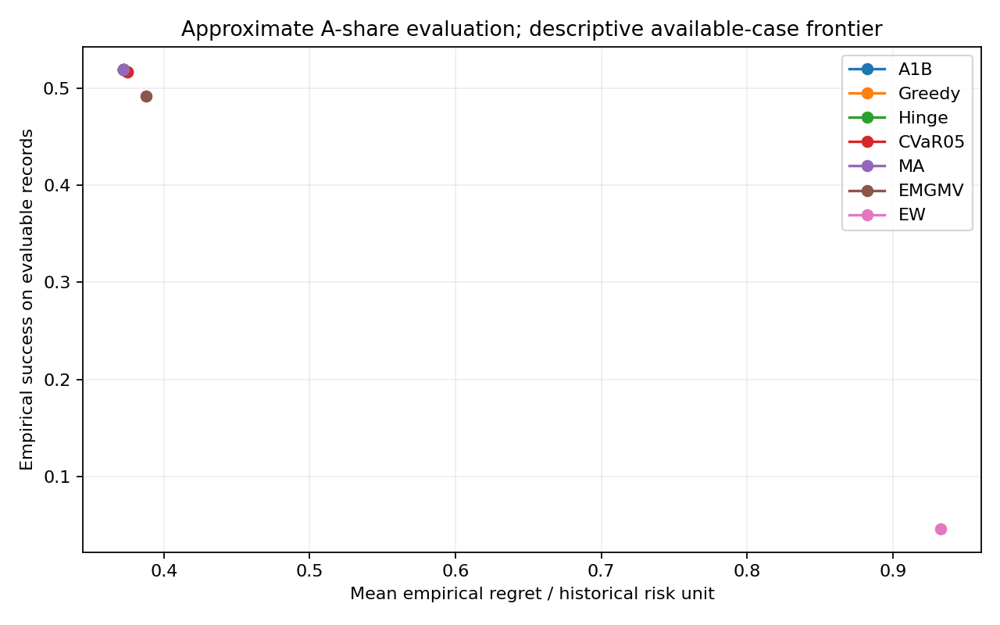
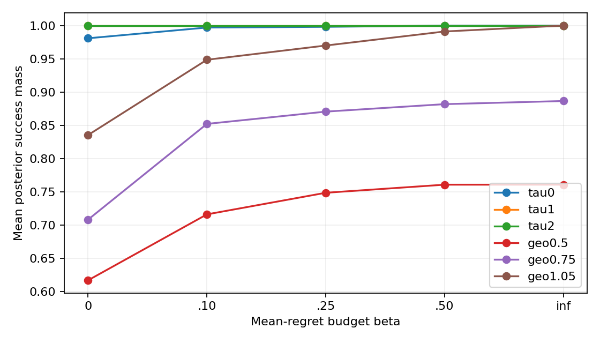
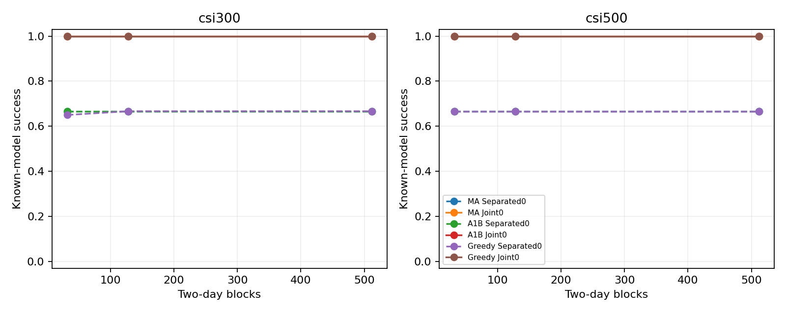
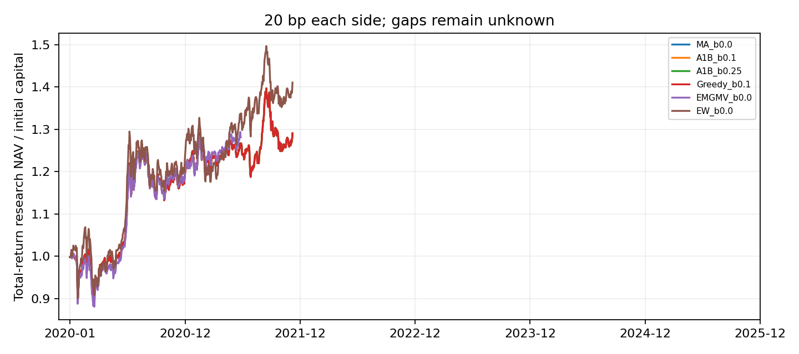

# research_v5b：近似真实 A 股实验与机制验证

**阶段性汇总：仍有冻结实例未执行，完成规模实验后更新。**

本报告的真实评价采用总收益估值近似：缺失期间沿用上一估值，恢复日计入累计变化。训练端仍保留 NaN。结果不代表精确可交易回测或真实市场风险保证。

## 配置与完成情况

冻结 τ=[0.1241315329697926, 0.29580796068642345, 0.8836513534481872]；η_F1=0.3，η_R3=1.0，η_F2=0.3。主估值陈旧期63日，敏感性20/126日，严格完整口径另列。
主跑批计划 1228 项，完整完成 587 项；不可用/失败/尚未运行均保留清单，不根据胜负删减。
半合成、信息视图、R1枚举另有独立记录，未计入上述主跑批数量。2019年末目标用于初始建仓；2026单列。

## 真实风险比较（公共可评价记录的描述性结果）

下表不能替代固定月历上的区间推断。不同估计器可用性可能不同，LW缺失时不插补。正式主要比较使用同一月历、同一数据配对。

|方法|可评价记录|达标率|平均 regret/u|p95 regret/u|模型内达标质量|
|---|---:|---:|---:|---:|---:|
|A1B-guarded:0.1|372|51.882%|0.37241|0.96731|100.000%|
|A1B-guarded:0.25|372|51.882%|0.37241|0.96731|100.000%|
|A1B:0.1|372|51.882%|0.37241|0.96731|100.000%|
|A1B:0.25|372|51.882%|0.37241|0.96731|100.000%|
|A1B:0.5|372|51.882%|0.37241|0.96731|100.000%|
|A1B:inf|372|51.882%|0.37241|0.96731|100.000%|
|CVaR025:0.1|372|50.538%|0.37704|1.02288|100.000%|
|CVaR025:0.25|372|50.538%|0.37764|1.01984|100.000%|
|CVaR05:0.1|372|51.613%|0.37493|0.98370|100.000%|
|CVaR05:0.25|372|51.613%|0.37501|0.98372|100.000%|
|EMGMV:0.0|372|49.194%|0.38784|1.08808|98.440%|
|EW:0.0|372|4.570%|0.93269|2.88078|34.935%|
|Greedy1swap:0.1|372|51.882%|0.37241|0.96731|100.000%|
|Greedy1swap:0.25|372|51.882%|0.37241|0.96731|100.000%|
|Greedy:0.1|372|51.882%|0.37241|0.96731|100.000%|
|Greedy:0.25|372|51.882%|0.37241|0.96731|100.000%|
|Hinge:0.1|372|51.882%|0.37241|0.96731|100.000%|
|Hinge:0.25|372|51.882%|0.37241|0.96731|100.000%|
|InverseVol:0.0|372|8.602%|0.75823|2.26715|50.220%|
|LW:0.0|97|51.546%|0.38556|1.01444|99.981%|
|MA:0.0|372|51.882%|0.37241|0.96731|100.000%|

## 六项预设推断

|比较|全月历效应区间|Holm p|
|---|---|---|
|success β=0.1 MA:0.0|[-0.1389, 0.1389]|1.0|
|success β=0.1 Greedy:0.1|[-0.1389, 0.1389]|1.0|
|success β=0.25 MA:0.0|[-0.1389, 0.1389]|1.0|
|success β=0.25 Greedy:0.25|[-0.1389, 0.1389]|1.0|
|mean_cost β=0.1 |连续损失未决，未计算全样本检验|None|
|mean_cost β=0.25 |连续损失未决，未计算全样本检验|None|

采用10,000次同步循环月份块重采样，主块长6，敏感性3/12；缺失成功率按区间传播。无法有限界定的连续损失不输出全样本p值。六项检验中的不可计算项不被解释为零效应。

## 估值、账本与机制边界

20/63/126日和严格完整口径见 `output/valuation_sensitivity.json`；同一目标不重新调参。账户以可分割总收益单位计价、下一交易日收盘调整，成本每边0/10/20/50bp。无记录证券不成交，池外遗留持仓不删除，不重复发放分红。未知估值暂停交易并保留净值未决。
账本聚合见 `output/book_summary.json`，半合成见 `output/bridge_summary.json`，共同观测见 `output/information_summary.json`。模型内目标改善、已知高斯真模型改善、未来经验改善分别解释，不能相互替代。

## 复现与未完成项

私有运行目录保存矩阵、似然、目标、执行单位及原始证书。公开目录只保存代码、配置、聚合记录和哈希。原v5、v4a及源数据保持不变；本轮默认本地提交。
完整清单见 `output/scheduled_manifest.json`、`output/failure_and_unfinished.json`；累计CPU见 `output/runtime_snapshot.json`，包含此前v5用量。对失败不放宽ε或预算；开放证书与回退单列。

## R1：历史风险库的价格台阶与数值核验

独立价格记录 5376 个，预算前沿记录 420 个；A1-B 持仓成功质量下界超出枚举可能质量上界的冲突 0 个。CVXPY 的值只是独立建模参考，不当作严格对偶证书。
逐集合价格、独立模型状态及区间距离见 `output/r1_price_audit.json`，前沿见 `output/r1_frontiers.json`。开放数值区间不被强行闭合。

所有可行子集的预算跳点区间见 `output/r1_budget_jump_intervals.json`；不是仅以五个绘图点替代完整枚举。

## 历史校准的半合成机制

两个固定历史族、每真模型10次独立重复；同一次模拟数据用于两个等标量预算视图。先验行只评价一次决策，不算六次独立实验。下表是 n=512 的已知真模型结果；样本很小，不能外推全部风险族。

|历史族|阈值|视图|方法/预算|成功率|最坏真模型成功率|平均 regret|
|---|---|---|---:|---:|---:|---:|
|csi300|tau|Joint0|MA/0.0|100.000%|100.000%|4.032339e-19|
|csi300|tau|Joint0|A1B/0.1|100.000%|100.000%|4.032339e-19|
|csi300|tau|Joint0|Greedy/0.1|100.000%|100.000%|4.032339e-19|
|csi300|tau|Joint0|A1B/0.25|100.000%|100.000%|4.032339e-19|
|csi300|tau|Joint0|Greedy/0.25|100.000%|100.000%|4.032339e-19|
|csi300|geo0.5|Joint0|MA/0.0|100.000%|100.000%|4.032339e-19|
|csi300|geo0.5|Joint0|A1B/0.1|100.000%|100.000%|4.032339e-19|
|csi300|geo0.5|Joint0|Greedy/0.1|100.000%|100.000%|4.032339e-19|
|csi300|geo0.5|Joint0|A1B/0.25|100.000%|100.000%|4.032339e-19|
|csi300|geo0.5|Joint0|Greedy/0.25|100.000%|100.000%|4.032339e-19|
|csi300|geo0.75|Joint0|MA/0.0|100.000%|100.000%|4.032339e-19|
|csi300|geo0.75|Joint0|A1B/0.1|100.000%|100.000%|4.032339e-19|
|csi300|geo0.75|Joint0|Greedy/0.1|100.000%|100.000%|4.032339e-19|
|csi300|geo0.75|Joint0|A1B/0.25|100.000%|100.000%|4.032339e-19|
|csi300|geo0.75|Joint0|Greedy/0.25|100.000%|100.000%|4.032339e-19|
|csi300|geo1.05|Joint0|MA/0.0|100.000%|100.000%|4.032339e-19|
|csi300|geo1.05|Joint0|A1B/0.1|100.000%|100.000%|4.032339e-19|
|csi300|geo1.05|Joint0|Greedy/0.1|100.000%|100.000%|4.032339e-19|
|csi300|geo1.05|Joint0|A1B/0.25|100.000%|100.000%|4.032339e-19|
|csi300|geo1.05|Joint0|Greedy/0.25|100.000%|100.000%|4.032339e-19|
|csi300|tau|Separated0|MA/0.0|100.000%|100.000%|1.463614e-06|
|csi300|tau|Separated0|A1B/0.1|100.000%|100.000%|1.463614e-06|
|csi300|tau|Separated0|Greedy/0.1|100.000%|100.000%|1.463614e-06|
|csi300|tau|Separated0|A1B/0.25|100.000%|100.000%|1.463614e-06|
|csi300|tau|Separated0|Greedy/0.25|100.000%|100.000%|1.463614e-06|
|csi300|geo0.5|Separated0|MA/0.0|33.333%|0.000%|1.463614e-06|
|csi300|geo0.5|Separated0|A1B/0.1|66.667%|0.000%|1.480597e-06|
|csi300|geo0.5|Separated0|Greedy/0.1|66.667%|0.000%|1.491236e-06|
|csi300|geo0.5|Separated0|A1B/0.25|66.667%|0.000%|1.480597e-06|
|csi300|geo0.5|Separated0|Greedy/0.25|66.667%|0.000%|1.491236e-06|
|csi300|geo0.75|Separated0|MA/0.0|66.667%|0.000%|1.463614e-06|
|csi300|geo0.75|Separated0|A1B/0.1|66.667%|0.000%|1.463614e-06|
|csi300|geo0.75|Separated0|Greedy/0.1|66.667%|0.000%|1.50906e-06|
|csi300|geo0.75|Separated0|A1B/0.25|66.667%|0.000%|1.463614e-06|
|csi300|geo0.75|Separated0|Greedy/0.25|66.667%|0.000%|1.708223e-06|
|csi300|geo1.05|Separated0|MA/0.0|83.333%|0.000%|1.463614e-06|
|csi300|geo1.05|Separated0|A1B/0.1|100.000%|100.000%|1.483304e-06|
|csi300|geo1.05|Separated0|Greedy/0.1|100.000%|100.000%|1.499415e-06|
|csi300|geo1.05|Separated0|A1B/0.25|100.000%|100.000%|1.483304e-06|
|csi300|geo1.05|Separated0|Greedy/0.25|100.000%|100.000%|1.499415e-06|
|csi500|tau|Joint0|MA/0.0|100.000%|100.000%|6.637106e-19|
|csi500|tau|Joint0|A1B/0.1|100.000%|100.000%|6.637106e-19|
|csi500|tau|Joint0|Greedy/0.1|100.000%|100.000%|6.637106e-19|
|csi500|tau|Joint0|A1B/0.25|100.000%|100.000%|6.637106e-19|
|csi500|tau|Joint0|Greedy/0.25|100.000%|100.000%|6.637106e-19|
|csi500|geo0.5|Joint0|MA/0.0|100.000%|100.000%|6.637106e-19|
|csi500|geo0.5|Joint0|A1B/0.1|100.000%|100.000%|6.637106e-19|
|csi500|geo0.5|Joint0|Greedy/0.1|100.000%|100.000%|6.637106e-19|
|csi500|geo0.5|Joint0|A1B/0.25|100.000%|100.000%|6.637106e-19|
|csi500|geo0.5|Joint0|Greedy/0.25|100.000%|100.000%|6.637106e-19|
|csi500|geo0.75|Joint0|MA/0.0|100.000%|100.000%|6.637106e-19|
|csi500|geo0.75|Joint0|A1B/0.1|100.000%|100.000%|6.637106e-19|
|csi500|geo0.75|Joint0|Greedy/0.1|100.000%|100.000%|6.637106e-19|
|csi500|geo0.75|Joint0|A1B/0.25|100.000%|100.000%|6.637106e-19|
|csi500|geo0.75|Joint0|Greedy/0.25|100.000%|100.000%|6.637106e-19|
|csi500|geo1.05|Joint0|MA/0.0|100.000%|100.000%|6.637106e-19|
|csi500|geo1.05|Joint0|A1B/0.1|100.000%|100.000%|6.637106e-19|
|csi500|geo1.05|Joint0|Greedy/0.1|100.000%|100.000%|6.637106e-19|
|csi500|geo1.05|Joint0|A1B/0.25|100.000%|100.000%|6.637106e-19|
|csi500|geo1.05|Joint0|Greedy/0.25|100.000%|100.000%|6.637106e-19|
|csi500|tau|Separated0|MA/0.0|100.000%|100.000%|1.362619e-06|
|csi500|tau|Separated0|A1B/0.1|100.000%|100.000%|1.362619e-06|
|csi500|tau|Separated0|Greedy/0.1|100.000%|100.000%|1.362619e-06|
|csi500|tau|Separated0|A1B/0.25|100.000%|100.000%|1.362619e-06|
|csi500|tau|Separated0|Greedy/0.25|100.000%|100.000%|1.362619e-06|
|csi500|geo0.5|Separated0|MA/0.0|33.333%|0.000%|1.362619e-06|
|csi500|geo0.5|Separated0|A1B/0.1|66.667%|0.000%|1.377375e-06|
|csi500|geo0.5|Separated0|Greedy/0.1|66.667%|0.000%|1.387205e-06|
|csi500|geo0.5|Separated0|A1B/0.25|66.667%|0.000%|1.377375e-06|
|csi500|geo0.5|Separated0|Greedy/0.25|66.667%|0.000%|1.387205e-06|
|csi500|geo0.75|Separated0|MA/0.0|66.667%|0.000%|1.362619e-06|
|csi500|geo0.75|Separated0|A1B/0.1|66.667%|0.000%|1.362619e-06|
|csi500|geo0.75|Separated0|Greedy/0.1|66.667%|0.000%|1.362619e-06|
|csi500|geo0.75|Separated0|A1B/0.25|66.667%|0.000%|1.362619e-06|
|csi500|geo0.75|Separated0|Greedy/0.25|66.667%|0.000%|1.362619e-06|
|csi500|geo1.05|Separated0|MA/0.0|83.333%|0.000%|1.362619e-06|
|csi500|geo1.05|Separated0|A1B/0.1|100.000%|100.000%|1.384362e-06|
|csi500|geo1.05|Separated0|Greedy/0.1|100.000%|100.000%|1.402151e-06|
|csi500|geo1.05|Separated0|A1B/0.25|100.000%|100.000%|1.384362e-06|
|csi500|geo1.05|Separated0|Greedy/0.25|100.000%|100.000%|1.402151e-06|

其余样本量、尾部 regret 和预算资格见 `output/bridge_detailed.json`。等价类极限后验的全部集合价格见 `output/bridge_platform_prices.json`；该枚举平台与有限样本实际达标率含义不同。

## R3、R4与敏感性

自然缺失面板和规模对照均使用同组内共同输入。所有阈值、预算、CVaR水平、N/M、2026延伸结果保存在 `output/all_threshold_budget_scale_tables.json`；不能从其中挑选最优一列代表预设主比较。信息实验逐日期的标量成本见 `output/information_summary.json`，Full使用双倍信息成本。
H=126与H=63在公共日期子集的比较见 `output/common_H63_H126.json`；未来交叉拟合参照见 `output/crossfit_signed_excess.json`，有符号超额风险可为负。

## 完整性与解释

方法输入哈希一致性：True；已评价持仓约束不合格记录：0。模型内MA重合、回退与开放状态以及共享前端成本见 `output/postrun_integrity.json`。
本轮冻结后新增的汇总代码只读取结果，不参与模型、阈值或持仓生成。完整指数扩展在测试前因开发计时预算排除；该缺口不能用N=100结果代替。

## 三项最终判断的使用原则

半合成只支持这两个历史校准族中的机制判断；真实结果只有固定月份配对区间及成本敏感性共同支持时，才可说有稳健改善。若算法与MA或贪心重合，记为真实风险库中的前沿退化或没有额外增益，不能转用几何阈值包装成主要实证成功。

## 总收益指数研究账本与成本

下表仅对净值全程可评价的账本计算年化结果；完整数少于6时，不得解释为六个预设面板的总体表现。费用、换手和暴露为实际可观察期间的诊断，未知期间没有被记为零收益。各成本场景完整结果见 `output/book_cost_tables.json`。

|方法|每边成本bp|完整账本/6|完整账本平均年化收益|平均年化波动|观察期平均暴露|
|---|---:|---:|---:|---:|---:|
|A1B-guarded_b0.1|20|1/6|4.29%|15.88%|99.99%|
|A1B-guarded_b0.25|20|1/6|4.29%|15.88%|99.99%|
|A1B_b0.1|20|1/6|4.29%|15.88%|99.99%|
|A1B_b0.25|20|1/6|4.29%|15.88%|99.99%|
|A1B_b0.5|20|1/6|4.29%|15.88%|99.99%|
|A1B_binf|20|1/6|4.29%|15.88%|99.99%|
|CVaR025_b0.1|20|2/6|2.79%|18.83%|99.99%|
|CVaR025_b0.25|20|2/6|2.68%|18.84%|99.99%|
|CVaR05_b0.1|20|1/6|4.31%|15.89%|99.99%|
|CVaR05_b0.25|20|2/6|2.73%|18.82%|99.99%|
|EMGMV_b0.0|20|1/6|3.59%|15.96%|100.00%|
|EW_b0.0|20|2/6|6.88%|22.83%|100.00%|
|Greedy1swap_b0.1|20|2/6|3.04%|18.81%|99.99%|
|Greedy1swap_b0.25|20|2/6|3.04%|18.81%|99.99%|
|Greedy_b0.1|20|2/6|3.04%|18.81%|99.99%|
|Greedy_b0.25|20|2/6|3.04%|18.81%|99.99%|
|Hinge_b0.1|20|1/6|4.29%|15.88%|99.99%|
|Hinge_b0.25|20|1/6|4.29%|15.88%|99.99%|
|InverseVol_b0.0|20|2/6|6.28%|21.65%|100.00%|
|LW_b0.0|20|4/6|2.18%|13.04%|55.13%|
|MA_b0.0|20|1/6|4.29%|15.88%|99.99%|

净值图严格按六个面板等权；任一个组成账本未知时，相应总体曲线留空，不改用剩余面板重新归一化。
