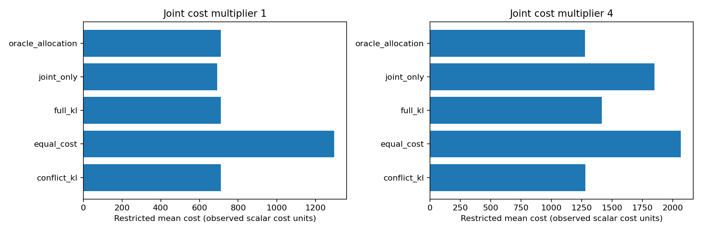
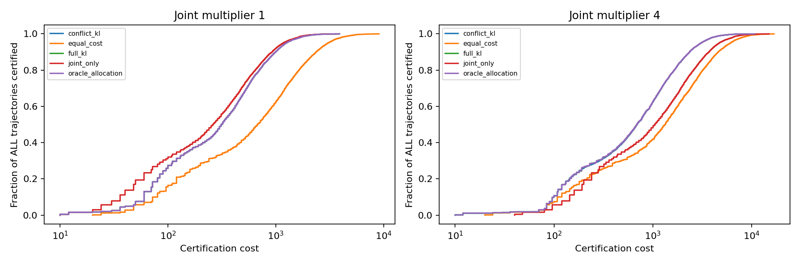
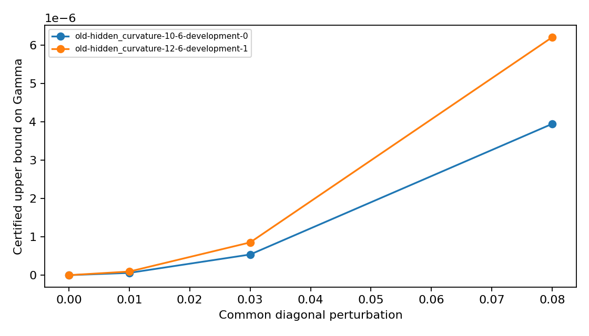
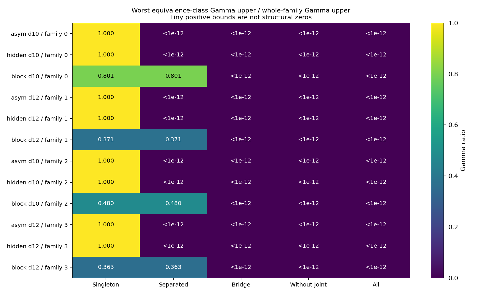
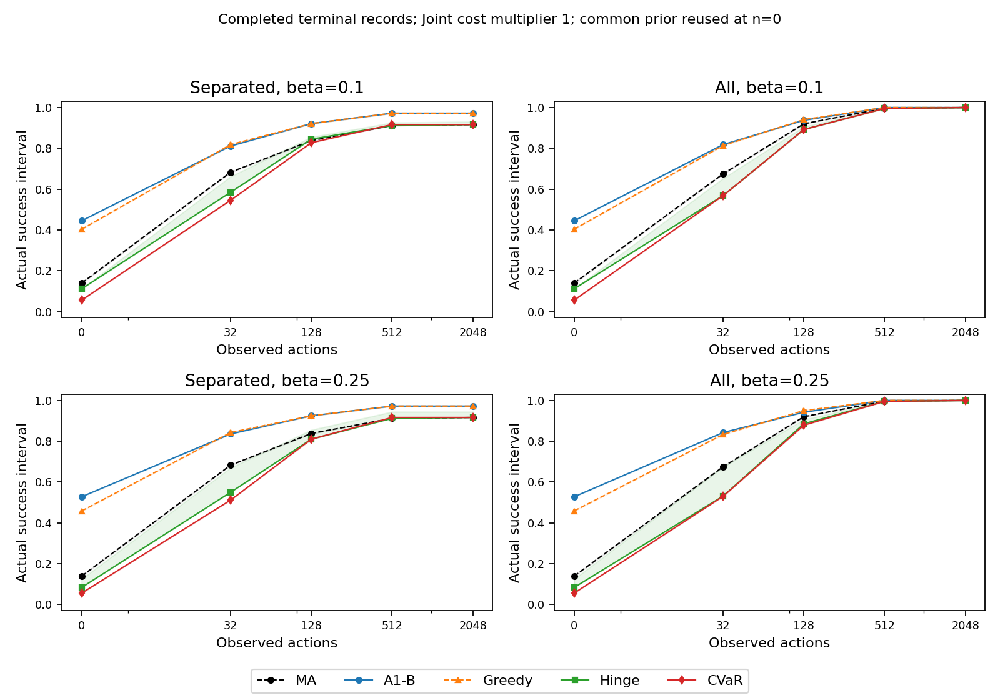
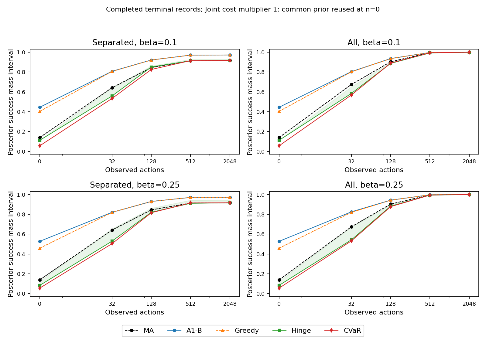
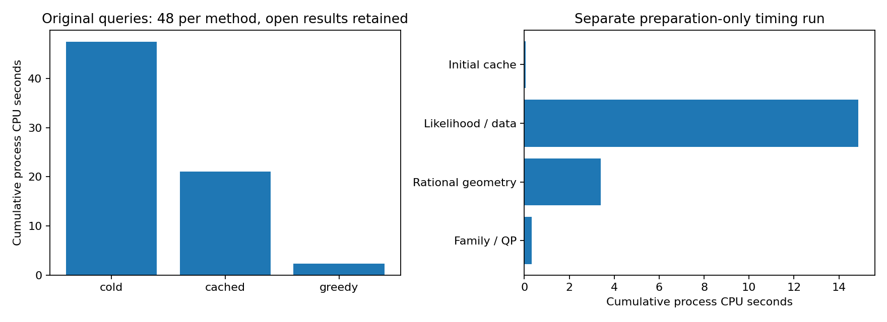

# research_v6：决策充分信息与自适应观测合成报告

本轮仅纯合成。新族/新种子与历史复现分栏；没有真实行情或历史校准半合成。四项研究问题的最终回答见[综合判断](INTERPRETATION_ZH.md)。理论和统计保证的条件见[理论状态](THEORY_STATUS_ZH.md)，实现调整见[开发日志](DEVELOPMENT_LOG_ZH.md)。

## 完成与研究边界

确认计划777,600条轨迹，已处理777,600，未运行0。预算耗尽未运行与轨迹内未认证分别报告；未按胜负筛选。

可用动作成本为观测d个标量，Joint溢价另计。所有方法共用固定先验整路径混合置信序列。oracle_allocation使用真模型的最优LP分配并保留强制探索，只作参照，不是理论下界。Separate-only只有一个合法动作，因此五种分配法是同一过程，仅运行一个代表。

77.76万项指方法/参数轨迹评估，不是77.76万个独立风险族。确认使用12个风险族、每族6个真模型、每真模型100个重复，即7,200组动作随机流；同组在方法、δ、ε及成本设置间配对复用。统计独立单位为风险族。开发记录及修订前记录不进入确认推断。

## 主参数的采样成本与认证

|Joint成本倍数|方法|轨迹数|认证率|错误认证|截断平均成本|
|---|---|---:|---:|---:|---:|
|1|conflict_kl|7200|99.972%|124|709.942|
|1|equal_cost|7200|99.972%|139|1295.239|
|1|full_kl|7200|99.972%|124|709.942|
|1|joint_only|7200|99.972%|127|691.201|
|1|oracle_allocation|7200|99.972%|124|709.942|
|4|conflict_kl|7200|99.972%|141|1279.868|
|4|equal_cost|7200|99.986%|146|2065.106|
|4|full_kl|7200|99.958%|138|1416.952|
|4|joint_only|7200|99.972%|127|1848.136|
|4|oracle_allocation|7200|99.972%|139|1277.451|

未认证成本按共同上限100,000d计入截断平均，不取成功停止子样本均值。标量、成本、独立时点及CPU不是同一量。全部δ/ε/设计见`results/sequential_summary.json`。

## 四项主要比较

|Joint倍数|冲突方法相对基线|成本减少|族级95%区间|Holm p|配对记录|
|---|---|---:|---|---:|---:|
|1|equal_cost|585.2975|[ 154.03864583 1006.838     ]|0.11368863113688632|7200|
|1|joint_only|-18.741388888888938|[-464.80600694  565.08527083]|0.5733426657334266|7200|
|4|equal_cost|785.2383333333332|[ 296.50830556 1257.78202778]|0.10678932106789321|7200|
|4|joint_only|568.2680555555556|[  42.48250694 1102.97409028]|0.14458554144585542|7200|

正的成本减少表示冲突方法成本较低，但必须结合认证率与错误核验。四项Holm检验均未达到0.05；表中的95%区间是未作多重校正的族级bootstrap区间。每类仅四个独立确认族；重复采样不能冒充新风险族。本表对应完整冻结确认清单。

## 理论诊断

旧隐藏曲率族包含非均匀对角扰动，H1≈0并不推出最终模型具有共同最优组合。消融的Γ、最优持仓差异及一阶响应误差在`S0_hidden_ablation.json`；移除扰动后数值近零与精确共同最优控制分开。

热图为最坏观测等价类Γ与全族Γ之比；共同组合的可认证性由阈值与类内Γ比较，不能仅由模型是否可辨识判断。新确认族的随机化平台及上下界见`results/confirmation_geometry.json`。

三模型两两兼容而整体冲突，随机选择pair center的最坏失败率1/3。它否定“Γ类>ε意味着任意固定δ随机化任务均不可能”的过强解释。有限答案的约简及Helly见证是经典工具；有限高斯族渐近成本下界已补成独立核查草稿，尚未经外部审阅，本轮启发式最优性仍未证明。T候选归一化结果不作有限样本下界检验。见[下界草稿](FINITE_GAUSSIAN_LOWER_BOUND_ZH.md)。

## 错误控制与数值

全部δ/ε/动作设置合计观察到错误认证9380次、真模型评价区间未决0次；这些共享数据且混合不同δ，不能合并成一个独立试验错误率再与某个δ比较。额外独立校准逐真模型二项区间见`results/calibration_errors.json`；零错误不能当作零风险。

理论错误控制依赖自适应动作的可预测性、正确有限候选族以及有效数值界。停止输出由有理持仓/弱对偶证书定义；浮点展示权重不是额外的精确保证。似然包络依赖IEEE误差模型，未做全软件形式化验证。

## 终端规则与求解

终端完成13016/34596个查询组，未运行21580组；该阶段内部额度停止，不代表12小时总预算耗尽。模型内成功、实际成功和预算资格见`results/terminal_summary.json`；冷启动/缓存/贪心结果见`results/S3_stress.json`。

A1-B作为信息耗尽的终端规则，不继承δ认证。旧平均代价证书开放状态保留。M=6枚举价格并保留跳点区间；M=12只报告查询结果和开放界，不声称枚举了所有跳点或证明了多项式加速。

实际持仓后验成功质量由共同regret区间及保存的似然误差包络重算，使用区间指数避免把下溢当作结构性零；原生API的质量下界另存。原生最优性间隙仍针对方法所接收的浮点后验，并保留后验精度开放状态，不与重算的质量混作一种证书。

β=0各方法均为MA端点；零观测只计算一次先验持仓。逐数据集的配对效应区间在`results/terminal_paired.json`，逐族最坏模型结果与真模型覆盖数在`results/terminal_worst_model.json`。未覆盖全部真模型的行不冒称完整最坏情形估计。未运行清单为`results/unrun_terminal.json.gz`和`results/unrun_confirmation.json.gz`。

以下终端图为已完成记录；线为成功质量/成功率下界，阴影为区间。n=0的共同先验复用于两种观测设计。原始查询成本与另行补测的公共准备成本分栏，不能将后者隐去后宣称端到端加速。

## 最终判断的依据

1. Γ等价类判据刻画共同组合的存在性；随机化平台与统一认证必须分开。隐藏曲率负结果不能仅凭名称解释。
2. 分配价值以主表和四项配对比较为准，任何优势限定本轮有限高斯族和动作成本。
3. 终端前沿用于量化妥协与贪心间隙；未完成项和开放证书不删去。
4. 论文转向是否值得继续，应看结构性解释和观测成本证据；不能把现有多答案识别、Ville或Helly工具重命名为原创。

CPU最终台账见`results/runtime.json`。完整轨迹按动作流种子、动作序列、排除证据和有理停止证书保存于独立运行目录，并无损归档。未自动发布GitHub。
