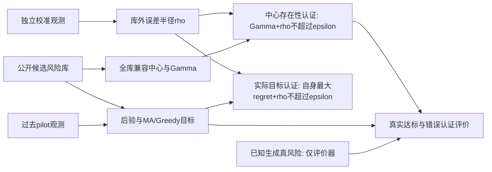

# research_v7 — library validity and decision sufficiency

本轮为算法收敛与机制核验，独立于 v4a/v5b/v6 冻结结果。主线是：先判断旧风险库是否已饱和，再区分库内充分性与库外有效性。默认本地分支交付。



`decision.solve`返回各预算的比较记录。其中 `method=Greedy` 是简单主规则：MA已全覆盖时原样返回MA，否则执行预算贪心。`method=A1-B` 是精确优化参照。没有通过外部认证时仍可报告终端持仓表现，但持仓不继承δ保证。

- [执行协议](EXECUTION_PROTOCOL_ZH.md)
- [原始研究建议](INPUT_PROPOSAL_ZH.md)
- [理论与数值资格](THEORY_ZH.md)
- [开发记录](DEVELOPMENT_LOG_ZH.md)
- [实验报告](REPORT_ZH.md)
- [论文证据整理](PAPER_SYNTHESIS_ZH.md)

## 复现

在仓库根目录运行。Python 环境需要 numpy/scipy/clarabel/cvxpy/highspy/pandas/matplotlib/mpmath/psutil/zstandard，具体版本记录于 `results/environment.json`。源码通过环境变量强制 BLAS 单线程。

```powershell
$env:V7_RUN_ROOT = 'D:\Portfolio_Optimization_paper\private_runs\integrated_v7'
$env:V7_V5B_ROOT = 'D:\Portfolio_Optimization_paper\private_runs\ashare_v5b'
python -B -m research_v7.supervisor gate
python -B -m research_v7.supervisor e1
python -B -m research_v7.supervisor prepare development
python -B -m research_v7.supervisor develop
python -B -m research_v7.supervisor review
python -B -m research_v7.supervisor smoke
python -B -m research_v7.supervisor prepare confirmation
python -B -m research_v7.supervisor freeze
python -B -m research_v7.supervisor confirm
python -B -m research_v7.supervisor e3
python -B -m research_v7.supervisor report
python -B -m research_v7.supervisor audit
python -B -m research_v7.supervisor archive
```

已冻结的交付版本不重复调用 `freeze`；保留已有配置和清单，直接运行 `prepare`、`confirm`。已有逐数据集记录会跳过，失败记录仍保留。修订后的实验不得覆盖原运行目录。`V7_V5B_ROOT` 仅 E1/可能的 E3 使用；纯合成运行不读取行情。E1 需要授权的旧私有数据和冻结目标，公开仓库不能单独重建真实数据诊断。

`manifest.json.gz` 固定独立确认工作单元。各条记录保存生成器、pilot/calibration 种子、似然、持仓、上下界、认证及终端结果。原始高斯观测通过种子、生成矩阵和版本重建；未把它们另存一份后再误称增加了独立样本。独立复演检查重建结果。

两档合成ε由数据产生前保存的Γ数值上界乘0.5或1.25定标，原始上下界均保留。留一实验使用其公开剩余候选库的Γ，不使用被删真模型来定阈值。此定标不会在难以判断时临时放宽。

同一输入中的方法顺序共享几何信息，A1-B还在同后验的预算查询间共享价格缓存。逐方法计时不包含已经发生的公共准备，不能据此作冷启动速度排名；逐数据流CPU和监督器台账包含端到端成本。`MA_full_data`是拆分成本参照，使用全部pilot/calibration观测，其余决策只使用pilot。`v6_pilot_CS`复用有限模型混合置信集的统计规则，只使用同一pilot流，并非原v6整套似然区间实现的性能复现；近门槛浮点资格另审计。

## 输出与隐私边界

公开 `results/` 保存聚合记录、图表、失败清单和 CPU 台账。真实证券标识、持仓、Q/p 及源数据审计明细保存在 `V7_RUN_ROOT`。合成完整记录也在该目录无损归档；归档清单与哈希可核验。不要把私有运行目录提交或上传。

`config_frozen.json` 绑定方法核心代码哈希。恢复时修改了方法会被拒绝。汇总、审计或文字修正不改变被冻结的统计设计；必要实现修订必须记录并重算同一清单。

E3 门槛不通过时只交付冻结的条件实验清单和未启动原因，不读取新真实训练数据、调小测试阈值或补造有利模型。该结果是本轮合格的停止结论。
