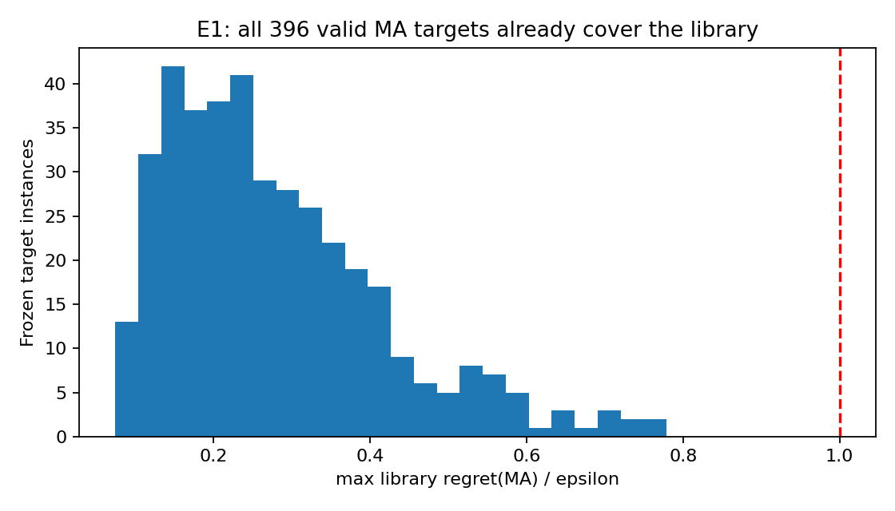
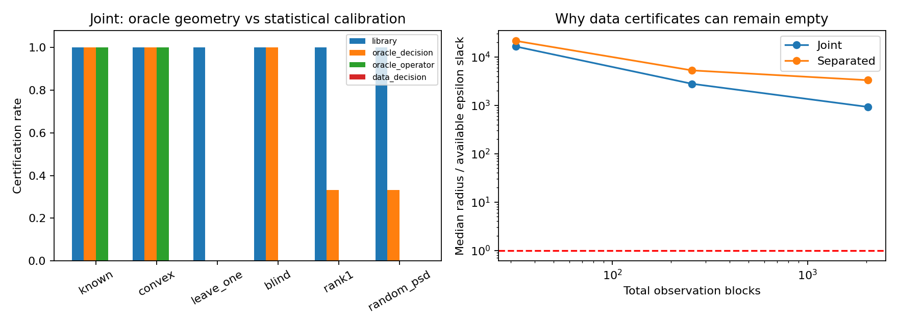
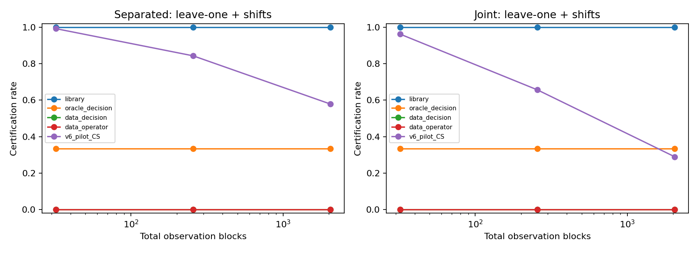
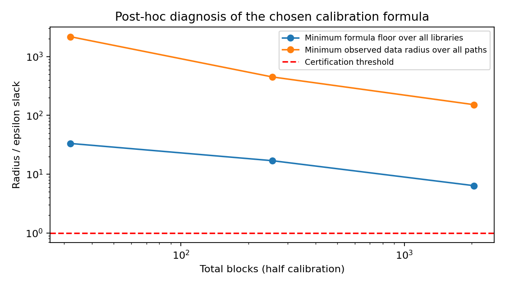
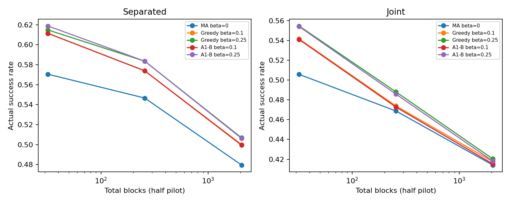

# v7：风险库有效性与决策充分性实验报告

本轮支持将实际决策收敛为MA饱和检查＋预算Greedy，保留A1-B作为核验工具。库外误差的几何机制成立，但当前数据半径尚不能成为可用认证算法，条件E3不启动。这个判断不把oracle对照当成现实方法，也不将旧实验与新确认合并为一项检验。

## 执行范围

确认数据流计划7040，已处理7040，失败0，未运行0。独立风险族为8个；多个检查点、阈值和方法不算新风险族。

## E1：真实风险库饱和

396个有效目标全部满足MA模型内覆盖；最大regret/ε均值0.2791、最大0.7790。Γ/ε均值0.1874、最大0.4960。

严格/近似共同可评价207项，最大损失差0。不同口径总体达标率不可忽略新增窗口的样本组成。已知内部成功窗口的未来失败识别区间为[45.20%, 51.26%]；不是总体真风险失败率。

旧主792次A1-B与MA同持仓；重新计算MA的L1差异为0。后验ESS均值8.30，候选oracle最大L1分歧的均值0.987，因此饱和不能简单解释为“只剩一个模型”或“所有oracle持仓相同”。12个专家仍有配置差异，只是ε覆盖了其风险regret分歧。

Γ诊断使用旧凸求解器：393项状态为AlmostSolved、3项为Solved，未升级为严格数值认证。MA覆盖结论直接来自逐模型regret上界和离阈值的明显余量，不依赖该Γ求解器达到严格最优。24个未来标签未决来自cross_phase_label；另有36个成分核验目标未决，均保留在原432项日历中。

## E2：内部充分与库外半径

|观测|方法|截至2048认证率|首次认证错误率|计划检查的截断平均成本|
|---|---|---:|---:|---:|
|Joint|data_decision|0.0000%|[0.0000%, 0.0000%]|22528.00|
|Joint|data_operator|0.0000%|[0.0000%, 0.0000%]|22528.00|
|Joint|library|100.0000%|[13.0682%, 13.0682%]|352.00|
|Joint|oracle_decision|54.5455%|[0.0000%, 0.0000%]|10432.00|
|Joint|oracle_operator|31.8182%|[0.0000%, 0.0000%]|15472.00|
|Joint|v6_pilot_CS|97.2727%|[13.1250%, 13.1250%]|949.93|
|Separated|data_decision|0.0000%|[0.0000%, 0.0000%]|22528.00|
|Separated|data_operator|0.0000%|[0.0000%, 0.0000%]|22528.00|
|Separated|library|100.0000%|[13.0682%, 13.0682%]|352.00|
|Separated|oracle_decision|54.5455%|[0.0000%, 0.0000%]|10432.00|
|Separated|oracle_operator|31.8182%|[0.0000%, 0.0000%]|15472.00|
|Separated|v6_pilot_CS|99.3466%|[10.5398%, 10.5398%]|492.89|

### Joint最终检查点的分场景结果

|情形|库内规则错误认证|oracle决策界认证|oracle算子界认证|数据决策界认证|旧v6错误认证|
|---|---:|---:|---:|---:|---:|
|known|0.000%|100.000%|100.000%|0.000%|0.000%|
|convex|0.000%|100.000%|100.000%|0.000%|2.500%|
|leave_one|47.917%|0.000%|0.000%|0.000%|19.062%|
|blind|0.000%|100.000%|0.000%|0.000%|0.625%|
|rank1|0.000%|33.333%|0.000%|0.000%|0.417%|
|random_psd|0.000%|33.333%|0.000%|0.000%|0.417%|

每族的22个预设真风险情形等权，不代表市场分布。known属于有限高斯族；convex仅表示协方差在凸库内。预设“all_misspecified”比较特指leave_one和shift面板，不包含convex的似然失配。库内规则和oracle几何在部分情形不依赖重复数据，重复观测不能扩大其独立几何样本数。

所有认证成本按32/256/2048三个计划检查点记录。库内或oracle规则有时可在零观测判断，因此该成本不是其理论最小样本复杂度。ratio=.5下，全库Γ+非负ρ必不能认证，这是保留的几何诊断；终端决策和缩小集合的v6对照另评。

数据方法错误率必须与认证率一起解释：始终拒绝也会得到零错误，零认证不能称为有用的风险控制。oracle半径仅作解释参照。旧v6置信集在失配面板无真模型覆盖保证。

图中仅含leave_one和shift面板，展示每个检查点的当前证书比例，不是累计停止比例。错库时旧v6的历史交集置信集可变空，因此这条曲线可能下降；前面的停止表保留首次认证事件。

## 四项预设比较

|观测|面板|认证率差|95%族级区间|Holm p|
|---|---|---:|---|---:|
|Separated|blind|0.000000|[0.0, 0.0]|1.000000|
|Separated|all_misspecified|0.000000|[0.0, 0.0]|1.000000|
|Joint|blind|0.000000|[0.0, 0.0]|1.000000|
|Joint|all_misspecified|0.000000|[0.0, 0.0]|1.000000|

## 冻结后的解释性诊断：公式宽度下限

在n=2048下，所有公开候选库中最小的公式宽度下限/ε余量为6.364。是否全部超过1：True。逐记录一致性核查42240次，违反0次。

该下限针对本轮坐标区间与统一振幅上界的组合公式，不是实际决策距离下界，更不是任何方法的信息论不可能性。它在确认开始后作为解释推导，未用于改动冻结方案或增加检验。详细证明见THEORY_ZH.md。

## 数值与终端资格

均值/尾部regret、预算资格与终端成功率见`results/terminal_summary.json`。只使用每单元预定前10重复，零样本按库复用。实际持仓的外部认证与几何中心的存在性判据分开。旧预算开放状态不自动修复。

分风险情形的结果在`results/terminal_panels.json`，Greedy配对差在`results/terminal_paired.json`。未知数值预算与MA同持仓标记分别记录；身份相同不将近零L*的浮点误差自动改成严格预算证明。每个固定风险情形的错误率精确二项区间在`results/error_cells.json`，多情形合并的二项区间仅作描述，不宣称统一覆盖。

新半径为卡方区间加向外浮点余量，依赖正确高斯及数值误差假设；不是全软件形式化验证。E1的Γ界是旧凸求解器数值界，保留求解状态。

E3是否启动见`results/e3_gate.json`。理论推导及局限见[THEORY_ZH.md](THEORY_ZH.md)，最终论文证据整理见[PAPER_SYNTHESIS_ZH.md](PAPER_SYNTHESIS_ZH.md)。CPU、失败和未完成项全部保留。

### 终端达标与平均代价摘录（ε=0.5Γ，22种真风险等权）

|观测|总块数|方法|β|实际达标率|均值regret|p95 regret|区间预算认证率|
|---|---:|---|---:|---:|---:|---:|---:|
|Joint|32|A1-B|0.1|54.091%|0.00329436|0.0117342|100.00%|
|Joint|32|A1-B|0.25|55.398%|0.00324508|0.0117895|100.00%|
|Joint|32|Greedy|0.1|54.148%|0.00329367|0.0117342|100.00%|
|Joint|32|Greedy|0.25|55.455%|0.00324103|0.0117895|100.00%|
|Joint|32|MA|0.0|50.568%|0.00330331|0.0117054|0.00%|
|Joint|2048|A1-B|0.1|41.534%|0.00350908|0.0114665|44.55%|
|Joint|2048|A1-B|0.25|41.818%|0.00350743|0.0114665|44.83%|
|Joint|2048|Greedy|0.1|41.761%|0.003506|0.0114665|44.55%|
|Joint|2048|Greedy|0.25|42.045%|0.00350085|0.0114665|44.83%|
|Joint|2048|MA|0.0|41.420%|0.00350791|0.0114665|0.00%|
|Separated|0|A1-B|0.1|59.091%|0.00356078|0.0167418|100.00%|
|Separated|0|A1-B|0.25|60.795%|0.0038501|0.0190879|100.00%|
|Separated|0|Greedy|0.1|57.955%|0.00359212|0.0169218|100.00%|
|Separated|0|Greedy|0.25|59.091%|0.00358948|0.0167956|100.00%|
|Separated|0|MA|0.0|51.705%|0.00308821|0.0146224|0.00%|
|Separated|32|A1-B|0.1|61.136%|0.00287769|0.00954854|100.00%|
|Separated|32|A1-B|0.25|61.875%|0.00288943|0.00954854|100.00%|
|Separated|32|Greedy|0.1|61.136%|0.00287697|0.00954854|100.00%|
|Separated|32|Greedy|0.25|61.477%|0.00288309|0.00954854|100.00%|
|Separated|32|MA|0.0|57.045%|0.00284181|0.00884334|0.00%|
|Separated|2048|A1-B|0.1|49.943%|0.00318196|0.00954853|91.76%|
|Separated|2048|A1-B|0.25|50.625%|0.00317947|0.00954853|92.16%|
|Separated|2048|Greedy|0.1|50.000%|0.00316329|0.00954853|91.76%|
|Separated|2048|Greedy|0.25|50.682%|0.003145|0.00954853|92.16%|
|Separated|2048|MA|0.0|47.955%|0.00319256|0.00885058|0.00%|

零样本仅记录一个共同先验视图。上表是描述性终端比较，不属于四项主检验；大量重复不增加独立风险族数。MA零预算返回政策不变，其浮点oracle误差区间仍开放。精确求解器没有稳定超过贪心，信息增加后预算资格也会因后验集中和近零L*而开放。

Joint下MA在known面板的达标率从n=32的74.58%升至n=2048的100%；在convex面板却从56.25%降至26.25%。后者的协方差在凸库内，但生成密度不属于有限候选族。更多观测可使错误工作模型的后验更集中，不能将合并曲线下降解释为“数据本身有害”。该机制与有限正确模型的Bayes均值最优性不矛盾。
